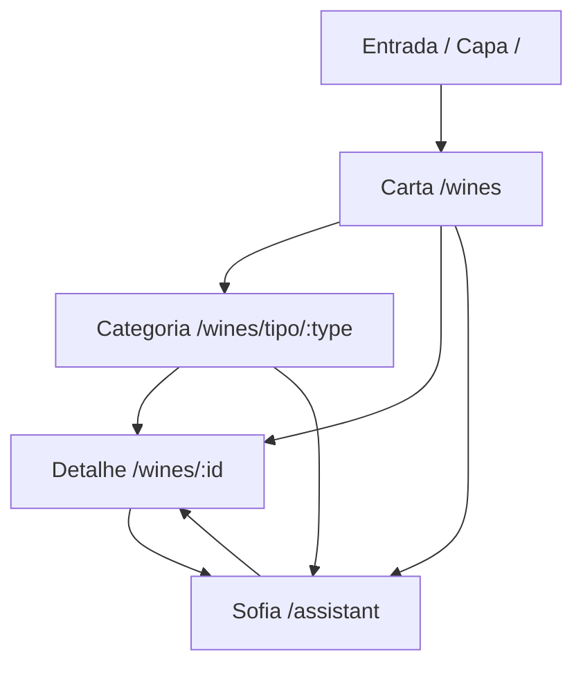
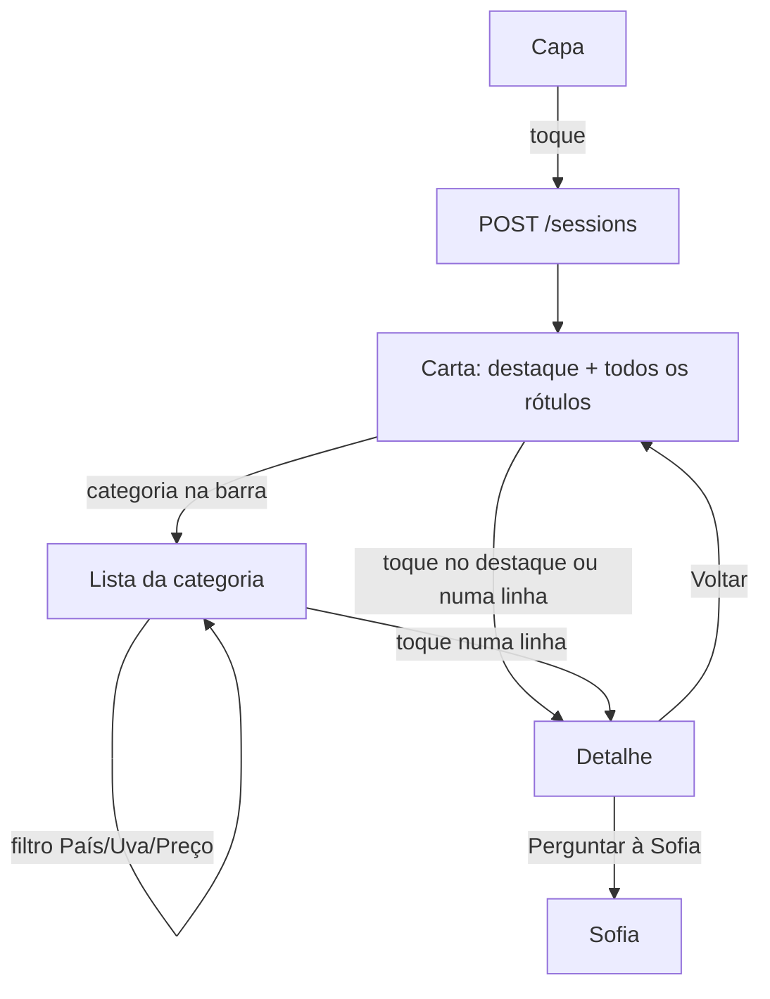

# Vinia — Especificação de UI/UX do Tablet (Carta Digital)

> Status: **rascunho v0.2 para revisão** | Autoria: Uma (@ux-design-expert) | Data: 2026-10-06
> Escopo: PWA do tablet (`vinia-src/frontend`). O backoffice (Livewire) está fora desta spec.
> Relação com specs existentes: **atualiza o "Design / UX" da F005** (`vinia-specs/features/F005-digital-menu.md`). Os desvios aprovados estão na seção 9. A F005 **não foi editada**: a revisão dela é do @pm.

---

## 1. Introdução

Define metas de experiência, arquitetura de informação, fluxos, layout e especificações visuais da carta digital em tablet. Base visual: protótipo v2 (`vinia-src/prototipo/vinia-app.jsx`, `vinia-ui.jsx`), que é **retrato de celular (402×874)**. Esta spec o adapta para tablet em paisagem.

### 1.1 Persona e contexto de uso

**Comensal à mesa.** Tablet apoiado na mesa, a 50–70 cm, luz baixa, **1 a 2 pessoas** olhando juntas, toque com um dedo, sessão curta (a sessão fecha após 3 min de inatividade, RN03), sem login (RN05), sem hover.

### 1.2 Metas de usabilidade

| Meta | Critério |
|---|---|
| Descobrir um vinho | Do toque inicial a um rótulo aberto em **2 toques** a partir da carta (hoje 3 telas) |
| Ler sem esforço | Texto corrido ≥ 16px; rótulos em caixa-alta ≥ 13px; contraste AA |
| Tocar sem errar | Alvos ≥ 48px; linhas de lista ≥ 72px; botões primários 56px |
| Ler a dois | Informação em colunas largas, sem depender da orientação do texto |
| Não se perder | A categoria atual fica sempre visível (paisagem) |

### 1.3 Princípios

1. **Editorial, não e-commerce:** listas, filetes de ouro e tipografia serifada; fotos são bem-vindas, nunca obrigatórias.
2. **Tudo legível à distância:** escala tipográfica de tablet, não de celular.
3. **Uma coisa por vez:** o detalhe ocupa a tela inteira; a navegação some quando não é necessária.
4. **Tokens, não valores soltos:** nenhuma cor, tamanho ou espaçamento hardcoded em página.
5. **Acessível por padrão:** WCAG AA como piso.

### 1.4 Change log

| Data | Versão | Descrição | Autor |
|---|---|---|---|
| 2026-10-06 | 0.1 | Rascunho a partir da análise protótipo × frontend e das decisões do Rafael | Uma |
| 2026-10-07 | 0.2 | Wireframes HTML (`docs/design/wireframes-tablet.html`); lista em 2 colunas fixas (corrige o `auto-fit`) | Uma |

---

## 2. Dispositivos e breakpoints

| Dispositivo (CSS px) | Orientação | Layout |
|---|---|---|
| iPad 10,2" 1080×810 · Air 10,9" 1180×820 · Pro 11" 1194×834 · Android 10" 1280×800 · Pro 12,9" 1366×1024 | **Paisagem (principal)** | Barra lateral + painel |
| iPad Pro 12,9" retrato 1024×1366 | Retrato largo | Barra lateral + painel (lista cai para 1 coluna pela largura) |
| iPad 10,2"/Air/Pro 11" retrato (810–834 de largura) | **Retrato (fallback)** | Faixa de chips no topo + lista de 1 coluna |

- **Projetar em 1180×820.** Testar em 1080×810 e 1366×1024.
- **Breakpoint único:** `lg` = **1024px** (padrão do Tailwind v4). `≥ lg` = barra lateral; `< lg` = fallback retrato.
- **Lista:** **2 colunas fixas** (`repeat(2, minmax(0, 1fr))`, espaço de 36px) em `≥ lg`, e **1 coluna** em `< lg`. (Um `auto-fit` com mínimo de 380px foi descartado: no iPad Air, de 1180px, sobra 792px úteis e a lista cairia em 1 coluna.) Cada coluna tem ~336px em 1080 e ~558px em 1366.
- O manifest declara `orientation: landscape`; para o **fallback retrato valer de fato, esse campo deve ser removido** (ver seção 10, item 1).

---

## 3. Arquitetura de informação



**Rotas** (sem mudança de URL): `/`, `/wines`, `/wines/tipo/:type`, `/wines/:id`, `/assistant`.
**Estrutura:** `/wines` e `/wines/tipo/:type` passam a ser filhas de um **layout compartilhado (`AppShell`)** com a barra lateral; `/wines/:id` e `/assistant` ficam fora dele (tela própria).

**Navegação primária:** barra lateral de categorias (paisagem) ou faixa de chips rolável (retrato). **Secundária:** filtros País / Uva / Preço em chips. **Voltar:** botão de 56×56 no canto superior esquerdo das telas de detalhe e Sofia (`navigate(-1)`).

---

## 4. Fluxos

### 4.1 Explorar e escolher um vinho

**Objetivo:** encontrar um rótulo e ler a ficha. **Entrada:** toque na capa. **Sucesso:** ficha aberta em ≤ 2 toques após a carta.



**Casos de borda:** rótulo esgotado (RN06): linha com opacidade reduzida e selo "Esgotado", sem navegação; categoria vazia: mensagem "Nenhum rótulo encontrado" com ação "Limpar filtros"; sem conexão: faixa fixa de aviso (RN08) e cache mantido; nome longo: corta em 2 linhas; sem foto: placeholder (seção 6.4); sessão falha ao criar: manter a capa e mostrar erro com "Tentar de novo".

### 4.2 Inatividade (RN03)

2,5 min sem toque abre "Ainda está aqui?" com contagem de 30 s; sem resposta, encerra a sessão e volta à capa. Mantém o comportamento atual; muda apenas o visual (seção 6.3).

### 4.3 Perguntar à Sofia

Mantém os fluxos atuais (Prato, Paladar, Comparar) e o polling de 1,5 s com "Sofia está pensando...". Só muda o layout (seção 5.4) e a linguagem visual.

---

## 5. Layouts das telas (1180×820)

### 5.1 Capa (`/`)

Tela cheia, fundo vinho com gradiente radial, marca centralizada. **Mantém:** logo e nome do restaurante vindos da API (RN02/CA01), botão "Ver Carta". **Adota do protótipo v2:** taça grande em traço, "VINIA" em tracking largo, filete de ouro, "Carta de Vinhos".
```
┌──────────────────────────────────────────────────────────────┐
│                                                              │
│                         ╭╮  (taça 80px)                      │
│                       V I N I A   (64px)                     │
│                       ───────────                            │
│                    CARTA DE VINHOS                           │
│                  {nome do restaurante}                       │
│                                                              │
│                  [   VER CARTA   ]  56px                     │
│                   toque para iniciar                         │
└──────────────────────────────────────────────────────────────┘
```

### 5.2 Carta e categoria (`/wines`, `/wines/tipo/:type`), paisagem

Barra lateral **300px** (340px em ≥ 1280). Painel com cabeçalho, filtros e lista em 2 colunas.
```
┌──────────────┬───────────────────────────────────────────────┐
│ ◇ VINIA      │ Vinhos Tintos                                 │
│              │ 18 rótulos      [País ▾] [Uva ▾] [Preço ▾]    │
│ ▸ Tintos  18 │ ─────────────────────────────────────────────  │
│   Brancos 12 │ [A] Almaviva           R$ 1.480 │ [S] Sassicaia│
│   Rosés    4 │     Viña Almaviva               │     Tenuta…  │
│   Espum.   6 │     Puente Alto · Cabernet · 19 │     Bolgheri │
│   Safras   4 │ ─────────────────────────────── │ ───────────  │
│   Fortif.  2 │ [C] Catena Adrianna     R$ 690  │ [Q] Quinta…  │
│              │ …                                │ …           │
│ ✦ Sofia      │                                                │
└──────────────┴───────────────────────────────────────────────┘
```
- **Sem categoria escolhida (`/wines`):** o painel abre com a **Sugestão do Sommelier** em destaque largo (foto/placeholder 240×320 à esquerda; nome 36px, produtor, região · safra, preço) e, abaixo, "Todos os rótulos" na mesma lista.
- **Barra lateral:** logo no topo; itens com 72px de altura (nome em serifada 24px, descrição 16px, contagem em ouro, `aria-current` no ativo); botão **Sofia** fixo no rodapé (contorno dourado, 56px).
- **Linha de vinho (≥ 72px):** miniatura 64×88 (foto ou placeholder), produtor (eyebrow), nome (24px, até 2 linhas), `região · uva · safra` (16px, `muted`), preço (22px) à direita.
- **Filtros:** chips de 48px de altura; cada um abre um painel (popover) com as opções existentes nos dados carregados; chip ativo em ouro com "×" para limpar. Filtro **Tipo = a própria barra lateral**.

### 5.3 Carta, retrato (fallback, `< 1024px`)

```
┌──────────────────────────────────────┐
│        ◇ VINIA              ✦ Sofia  │
│ [Tintos 18][Brancos 12][Rosés 4] ▸   │  ← faixa rolável, chips de 48px
│ [País ▾] [Uva ▾] [Preço ▾]           │
│ ──────────────────────────────────── │
│ [A] Almaviva              R$ 1.480   │  ← lista em 1 coluna
│     Viña Almaviva · Puente Alto      │
│ ──────────────────────────────────── │
│ …                                    │
└──────────────────────────────────────┘
```

### 5.4 Detalhe do rótulo (`/wines/:id`)

**Tela cheia, sem barra lateral.** Duas colunas: 42% hero / 58% conteúdo.
```
┌─────────────────────┬───────────────────────────────────────┐
│ ←                   │ PRODUTOR                              │
│   ┌─────────────┐   │ Nome do vinho            (44px)       │
│   │ foto ou     │   │ Região, País                          │
│   │ placeholder │   │ "notas de degustação"   (serifada it.)│
│   │  320×460    │   │ ┌───────┬───────┐                     │
│   └─────────────┘   │ │ Safra │ Uva   │  grade 2×2, 18px    │
│   fundo mais escuro │ │ Tipo  │ Origem│                     │
│   (--bg-deep)       │ └───────┴───────┘                     │
│                     │ UVAS  [chip][chip]                    │
│                     │ HARMONIZAÇÃO  ◡  texto 17px           │
│                     │ ─────────────────────────────────────  │
│                     │ GARRAFA  R$ 1.480        (30px)       │
│                     │ [  PERGUNTAR À SOFIA  ]  fixo, 56px   │
└─────────────────────┴───────────────────────────────────────┘
```
- A coluna de conteúdo **rola**; o botão fica fixo no rodapé dela.
- **Retrato:** uma coluna (hero no topo com 280×400, conteúdo abaixo), botão fixo no rodapé da tela.
- **Rótulo da seção de chips:** "Uvas" (hoje o app mostra as uvas sob o título "Notas de degustação"; corrigir o rótulo até existir um campo de descritores).

### 5.5 Sofia (`/assistant`), paisagem

Coluna esquerda de 300px com os fluxos (Prato, Paladar, Comparar, ícones de traço, 72px de altura); painel direito com a conversa/resposta, largura de leitura máxima de 720px, resposta em card `surface` com texto de 18px. **Retrato:** empilhado (menu de fluxos no topo como chips). Sem emojis; ícones de traço no estilo do protótipo.

---

## 6. Sistema de design

### 6.1 Escala tipográfica (tablet)

| Papel | Família | Tamanho / altura de linha | Peso |
|---|---|---|---|
| Marca (capa) | Cormorant Garamond | 64 / 1 | 500, tracking 0,42em |
| Título de página | Cormorant Garamond | 48 / 1,05 | 500 |
| Nome do vinho (detalhe) | Cormorant Garamond | 44 / 1,05 | 600 |
| Nome na lista / categoria na barra | Cormorant Garamond | 24 / 1,12 | 600 |
| Preço | Cormorant Garamond | 22–30 | 400 |
| Texto corrido | Inter | 17 / 1,55 | 400 |
| Texto secundário | Inter | 16 / 1,5 | 400 (`muted`) |
| Rótulo em caixa-alta (eyebrow, meta) | Inter | **13** / 1,2, tracking 0,22em | 600 |
| Botão | Inter | 15, caixa-alta, tracking 0,14em | 600 |

**Regra:** nenhum texto abaixo de 13px; texto de leitura nunca abaixo de 16px.

### 6.2 Tokens

Mantém os valores do protótipo **v2** (já usados em `frontend/src/index.css`). Ajustes:

| Token | Mudança | Motivo |
|---|---|---|
| `--faint` | alpha **0,32 → 0,50** (≈ 4,7:1 sobre o fundo; **a validar na implementação**) | Em 0,32 o contraste é **2,7:1**, abaixo do AA (4,5) |
| `--bg-deep` | **novo**: `#120E0C` | Fundo da coluna do hero (v2: `bgDeep`) |
| `--tracking-titulo` | **novo**: `0.02em` | Presente no guia do protótipo |
| Paleta fixa | **novo**: `vinho-velvet #4A0E17`, `ouro-champagne #D4AF37`, `papiro #F9F6F0`, `grafite #1C1C1C` | Presentes no guia, ausentes no `@theme` |
| `--color-primary/secondary` | **ligar** a `--wine` / `--gold` (hoje o `ThemeProvider` os grava e nada os usa) | RN02 |

Contraste medido (tokens atuais, fundo `#1A1513`): texto 15,7 · `muted` 5,5 · ouro 8,6 · texto sobre vinho 9,9 · `faint` 2,7 ✗. **Tema:** apenas escuro (spec F005); o tema claro não é escopo.

### 6.3 Componentes (Atomic Design)

| Nível | Componente | Variantes / estados |
|---|---|---|
| Átomo | `Eyebrow` | `gold`, `muted` |
| Átomo | `Rule` | `default`, `strong` (1px, `--hairline`) |
| Átomo | `Icon` | back, chevron, glass, close, sparkle(Sofia), plus |
| Átomo | `Button` | `primary` (vinho), `ghost` (contorno), `gold`; estados: default, pressed, disabled, loading; altura 56 |
| Átomo | `Chip` | `static` (uvas), `filter` (ativo/inativo, com "×") |
| Átomo | `WineThumb` | foto, placeholder; esgotado |
| Molécula | `CategoryItem` | default, ativo (`aria-current`), com contagem |
| Molécula | `WineRow` | default, esgotado, pressed |
| Molécula | `FilterChip` + `FilterPanel` | fechado, aberto, ativo |
| Molécula | `MetaCell`, `PriceBlock` | — |
| Organismo | `CategoryRail` (paisagem) / `CategoryStrip` (retrato) | — |
| Organismo | `FeaturedCard`, `WineList` (grid auto-fit) | vazio, carregando (skeleton), erro |
| Organismo | `DetailSplit`, `SofiaPanel` | paisagem / retrato |
| Organismo | `InactivityWarning`, `OfflineBanner` | já existem; restilizar (raio 4px, ícones de traço) e **ligar o `OfflineBanner`** (hoje não é usado) |
| Template | `AppShell` (rota-layout), `DetailLayout`, `CoverLayout` | — |

**Remover:** `WineCard` e `WineFiltersBar` atuais (não são usados; a F005 original previa cards e `<select>`, substituídos por este desenho), e `src/App.css` (sobra do template do Vite).

### 6.4 Placeholder de foto

A F005 pede "ícone de taça sobre fundo com cor secundária do restaurante". Usar a taça em traço (a mesma da marca) em ouro sobre fundo `color-mix(secundária 14%, --surface)`, com filete. Substitui a letra apagada de hoje.

### 6.5 Movimento

Transições entre telas de **200 ms** (`ease-out`): fade + 8px de deslocamento vertical. Respeitar `prefers-reduced-motion` (sem deslocamento). Pressed: escala 0,98 (sem `active:scale-95` agressivo).

---

## 7. Acessibilidade (WCAG AA)

- Contraste: ver 6.2; texto informativo só com `text`, `muted` ou `faint` (após o ajuste). `faint` antigo vira apenas decorativo.
- Alvos ≥ 48×48px (linhas ≥ 72px, botões 56px, chips 48px). Espaço mínimo de 8px entre alvos.
- Semântica: `nav` para a barra de categorias; listas em `ul/li`; botões reais (`button`), nunca `div` clicável; `aria-current="page"` no item ativo; `alt` nas fotos; `lang="pt-BR"`.
- Foco visível: anel de ouro de 2px (para teclado/acessibilidade do iPadOS).
- Rótulos em caixa-alta: manter o texto real em minúsculas no DOM e aplicar `text-transform`.
- Estados não dependem só de cor (esgotado = selo textual + opacidade).

## 8. Desempenho

Fotos com `loading="lazy"`, proporção fixa (sem deslocamento de layout), `decoding="async"`; skeleton na lista; polling de 60 s (RN07) e `staleTime` de 60 s mantidos; sem bibliotecas novas (apenas Tailwind v4 e o que já existe).

---

## 9. Desvios aprovados da F005 (por Rafael, 2026-10-06)

| Item da F005 | Desvio |
|---|---|
| "Grid de cards" com foto 16:9 (CA02, Design/UX) | **Lista em 2 colunas** com miniatura; foto opcional |
| Filtros no topo: Tipo, País, Uva, Faixa de preço | **Tipo = barra lateral**; País, Uva e Preço = chips com painel |
| "Fonte mínima: 16px" | Texto de leitura ≥ 16px; **rótulos em caixa-alta ≥ 13px** |
| "Layout landscape" | Paisagem principal **+ fallback em retrato** (< 1024px) |
| Botão "Perguntar à Sofia" (CA03) | Mantido |

## 10. Fora de escopo e perguntas em aberto

**Fora de escopo (exige decisão de produto/backend):** "Minha seleção" e "Chamar sommelier" (existem no protótipo, não na F005 nem na API); preço da taça, corpo, descritores de degustação e vinho em destaque curado (hoje o destaque é o mais caro).

**Em aberto (para a story e o @po):**
1. Remover `orientation: landscape` do manifest para o fallback retrato valer. Confirmar impacto no iPad instalado (o iOS pode manter a orientação do ícone existente; reinstalar).
2. Os painéis de filtro devem listar valores a partir dos rótulos carregados da categoria ou de todo o catálogo? (Recomendado: da categoria, com contagem.)
3. Intervalos do filtro de preço (faixas fixas ou mínimo/máximo livre?). A API aceita `min_price`/`max_price`.
4. Tabela de contraste final após o ajuste de `--faint` (validar na implementação).

## 11. Próximos passos

1. Revisão desta spec pelo Rafael → **v1.0**.
2. `*wireframe` de alta fidelidade (HTML) das 5 telas, nos dois formatos.
3. @pm atualiza a **F005** com os desvios da seção 9.
4. @sm cria a(s) story(ies) (sugestão: 1) tokens e átomos; 2) `AppShell` + lista; 3) detalhe; 4) capa; 5) Sofia e estados) → @po valida → @dev implementa → @qa (incluir `*a11y-check`).
