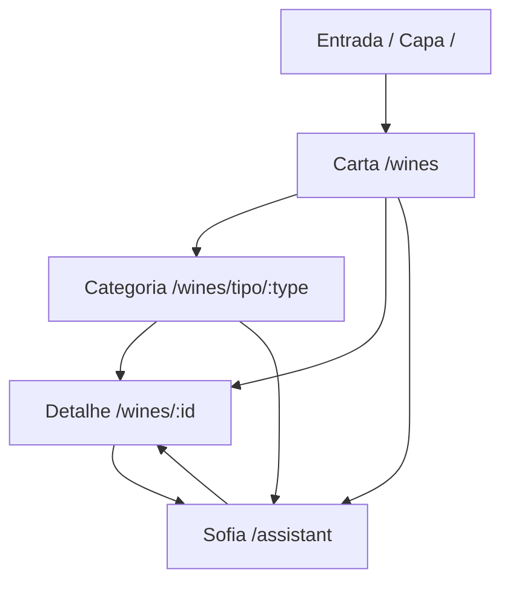
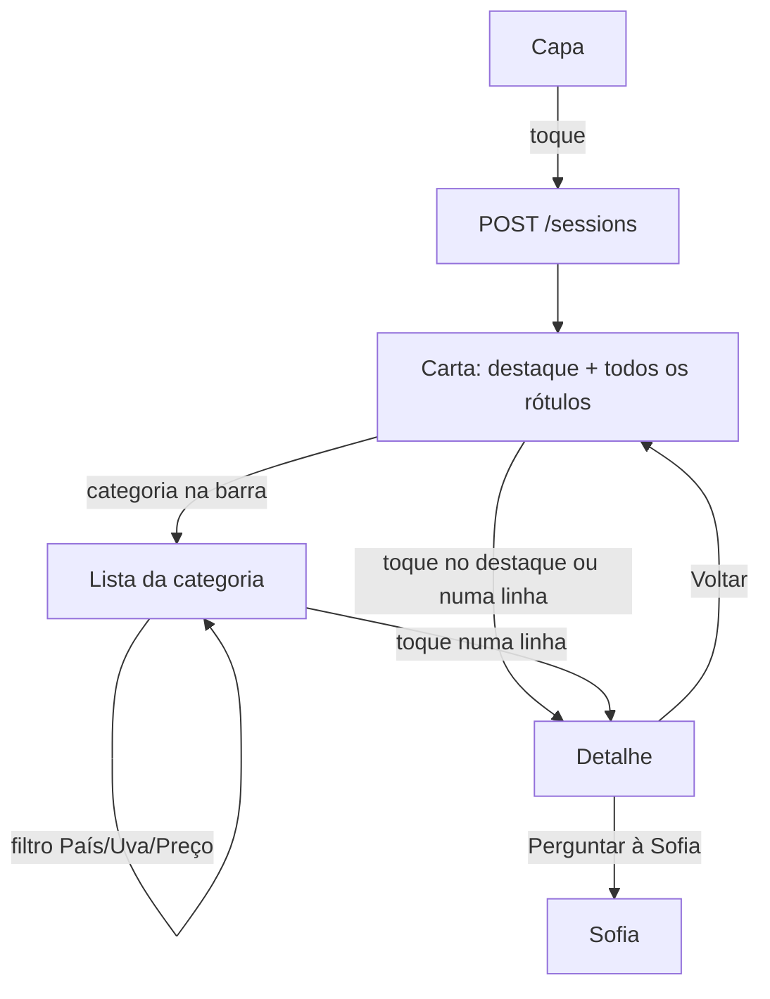

# Vinia — Especificação de UI/UX do Tablet (Carta Digital)

> Status: **rascunho v0.3 para revisão** | Autoria: Uma (@ux-design-expert) | Data: 2026-10-07
> Escopo: PWA do tablet (`vinia-src/frontend`). O backoffice (Livewire) está fora desta spec.
> Relação com specs existentes: **atualiza o "Design / UX" da F005** (`vinia-specs/features/F005-digital-menu.md`). Os desvios aprovados estão na seção 9. A F005 **não foi editada**: a revisão dela é do @pm.

---

## 1. Introdução

Define metas de experiência, arquitetura de informação, fluxos, layout e especificações visuais da carta digital em tablet. Base visual: protótipo v2 (`vinia-src/prototipo/vinia-app.jsx`, `vinia-ui.jsx`), que é **retrato de celular (402×874)**. Esta spec o adapta para tablet em paisagem.

### 1.1 Persona e contexto de uso

**Comensal à mesa.** Tablet apoiado na mesa, a 50–70 cm, luz baixa, **1 a 2 pessoas** olhando juntas, toque com um dedo, sessão curta (a sessão fecha após 3 min de inatividade, RN03), sem login (RN05), sem hover.

### 1.2 Metas de usabilidade

| Meta | Critério |
|---|---|
| Descobrir um vinho | Do toque inicial a um rótulo aberto em **2 toques** a partir da carta (hoje 3 telas) |
| Ler sem esforço | Texto corrido ≥ 16px; rótulos em caixa-alta ≥ 13px; contraste AA |
| Tocar sem errar | Alvos ≥ 48px; linhas de lista ≥ 72px; botões primários 56px |
| Ler a dois | Informação em colunas largas, sem depender da orientação do texto |
| Não se perder | A categoria atual fica sempre visível (paisagem) |

### 1.3 Princípios

1. **Editorial, não e-commerce:** listas, filetes de ouro e tipografia serifada; fotos são bem-vindas, nunca obrigatórias.
2. **Tudo legível à distância:** escala tipográfica de tablet, não de celular.
3. **Uma coisa por vez:** o detalhe ocupa a tela inteira; a navegação some quando não é necessária.
4. **Tokens, não valores soltos:** nenhuma cor, tamanho ou espaçamento hardcoded em página.
5. **Acessível por padrão:** WCAG AA como piso.

### 1.4 Change log

| Data | Versão | Descrição | Autor |
|---|---|---|---|
| 2026-10-06 | 0.1 | Rascunho a partir da análise protótipo × frontend e das decisões do Rafael | Uma |
| 2026-10-07 | 0.2 | Wireframes HTML (`docs/design/wireframes-tablet.html`); lista em 2 colunas fixas (corrige o `auto-fit`) | Uma |
| 2026-10-07 | 0.3 | **Tema claro e escuro à escolha do comensal** (pedido do Rafael; desvio da F005 na seção 9): paleta clara nos mesmos tokens, token `--gold-ink`, tabela de contraste calculada, controle `ThemeSwitch`, persistência por sessão (seção 6.6); wireframes com o tema claro | Uma |

---

## 2. Dispositivos e breakpoints

| Dispositivo (CSS px) | Orientação | Layout |
|---|---|---|
| iPad 10,2" 1080×810 · Air 10,9" 1180×820 · Pro 11" 1194×834 · Android 10" 1280×800 · Pro 12,9" 1366×1024 | **Paisagem (principal)** | Barra lateral + painel |
| iPad Pro 12,9" retrato 1024×1366 | Retrato largo | Barra lateral + painel (lista cai para 1 coluna pela largura) |
| iPad 10,2"/Air/Pro 11" retrato (810–834 de largura) | **Retrato (fallback)** | Faixa de chips no topo + lista de 1 coluna |

- **Projetar em 1180×820.** Testar em 1080×810 e 1366×1024.
- **Breakpoint único:** `lg` = **1024px** (padrão do Tailwind v4). `≥ lg` = barra lateral; `< lg` = fallback retrato.
- **Lista:** **2 colunas fixas** (`repeat(2, minmax(0, 1fr))`, espaço de 36px) em `≥ lg`, e **1 coluna** em `< lg`. (Um `auto-fit` com mínimo de 380px foi descartado: no iPad Air, de 1180px, sobra 792px úteis e a lista cairia em 1 coluna.) Cada coluna tem ~336px em 1080 e ~558px em 1366.
- O manifest declara `orientation: landscape`; para o **fallback retrato valer de fato, esse campo deve ser removido** (ver seção 10, item 1).

---

## 3. Arquitetura de informação



**Rotas** (sem mudança de URL): `/`, `/wines`, `/wines/tipo/:type`, `/wines/:id`, `/assistant`.
**Estrutura:** `/wines` e `/wines/tipo/:type` passam a ser filhas de um **layout compartilhado (`AppShell`)** com a barra lateral; `/wines/:id` e `/assistant` ficam fora dele (tela própria).

**Navegação primária:** barra lateral de categorias (paisagem) ou faixa de chips rolável (retrato). **Secundária:** filtros País / Uva / Preço em chips. **Voltar:** botão de 56×56 no canto superior esquerdo das telas de detalhe e Sofia (`navigate(-1)`).

---

## 4. Fluxos

### 4.1 Explorar e escolher um vinho

**Objetivo:** encontrar um rótulo e ler a ficha. **Entrada:** toque na capa. **Sucesso:** ficha aberta em ≤ 2 toques após a carta.



**Casos de borda:** rótulo esgotado (RN06): linha com opacidade reduzida e selo "Esgotado", sem navegação; categoria vazia: mensagem "Nenhum rótulo encontrado" com ação "Limpar filtros"; sem conexão: faixa fixa de aviso (RN08) e cache mantido; nome longo: corta em 2 linhas; sem foto: placeholder (seção 6.4); sessão falha ao criar: manter a capa e mostrar erro com "Tentar de novo".

### 4.2 Inatividade (RN03)

2,5 min sem toque abre "Ainda está aqui?" com contagem de 30 s; sem resposta, encerra a sessão e volta à capa. Mantém o comportamento atual; muda apenas o visual (seção 6.3).

### 4.3 Perguntar à Sofia

Mantém os fluxos atuais (Prato, Paladar, Comparar) e o polling de 1,5 s com "Sofia está pensando...". Só muda o layout (seção 5.4) e a linguagem visual.

---

## 5. Layouts das telas (1180×820)

### 5.1 Capa (`/`)

Tela cheia, fundo vinho com gradiente radial, marca centralizada. **Mantém:** logo e nome do restaurante vindos da API (RN02/CA01), botão "Ver Carta". **Adota do protótipo v2:** taça grande em traço, "VINIA" em tracking largo, filete de ouro, "Carta de Vinhos".
```
┌──────────────────────────────────────────────────────────────┐
│                                                              │
│                         ╭╮  (taça 80px)                      │
│                       V I N I A   (64px)                     │
│                       ───────────                            │
│                    CARTA DE VINHOS                           │
│                  {nome do restaurante}                       │
│                                                              │
│                  [   VER CARTA   ]  56px                     │
│                   toque para iniciar                         │
└──────────────────────────────────────────────────────────────┘
```

### 5.2 Carta e categoria (`/wines`, `/wines/tipo/:type`), paisagem

Barra lateral **300px** (340px em ≥ 1280). Painel com cabeçalho, filtros e lista em 2 colunas.
```
┌──────────────┬───────────────────────────────────────────────┐
│ ◇ VINIA      │ Vinhos Tintos                                 │
│              │ 18 rótulos      [País ▾] [Uva ▾] [Preço ▾]    │
│ ▸ Tintos  18 │ ─────────────────────────────────────────────  │
│   Brancos 12 │ [A] Almaviva           R$ 1.480 │ [S] Sassicaia│
│   Rosés    4 │     Viña Almaviva               │     Tenuta…  │
│   Espum.   6 │     Puente Alto · Cabernet · 19 │     Bolgheri │
│   Safras   4 │ ─────────────────────────────── │ ───────────  │
│   Fortif.  2 │ [C] Catena Adrianna     R$ 690  │ [Q] Quinta…  │
│              │ …                                │ …           │
│ ✦ Sofia      │                                                │
└──────────────┴───────────────────────────────────────────────┘
```
- **Sem categoria escolhida (`/wines`):** o painel abre com a **Sugestão do Sommelier** em destaque largo (foto/placeholder 240×320 à esquerda; nome 36px, produtor, região · safra, preço) e, abaixo, "Todos os rótulos" na mesma lista.
- **Barra lateral:** logo no topo; itens com 72px de altura (nome em serifada 24px, descrição 16px, contagem em ouro, `aria-current` no ativo); botão **Sofia** fixo no rodapé (contorno dourado, 56px).
- **Linha de vinho (≥ 72px):** miniatura 64×88 (foto ou placeholder), produtor (eyebrow), nome (24px, até 2 linhas), `região · uva · safra` (16px, `muted`), preço (22px) à direita.
- **Filtros:** chips de 48px de altura; cada um abre um painel (popover) com as opções existentes nos dados carregados; chip ativo em ouro com "×" para limpar. Filtro **Tipo = a própria barra lateral**.

### 5.3 Carta, retrato (fallback, `< 1024px`)

```
┌──────────────────────────────────────┐
│        ◇ VINIA              ✦ Sofia  │
│ [Tintos 18][Brancos 12][Rosés 4] ▸   │  ← faixa rolável, chips de 48px
│ [País ▾] [Uva ▾] [Preço ▾]           │
│ ──────────────────────────────────── │
│ [A] Almaviva              R$ 1.480   │  ← lista em 1 coluna
│     Viña Almaviva · Puente Alto      │
│ ──────────────────────────────────── │
│ …                                    │
└──────────────────────────────────────┘
```

### 5.4 Detalhe do rótulo (`/wines/:id`)

**Tela cheia, sem barra lateral.** Duas colunas: 42% hero / 58% conteúdo.
```
┌─────────────────────┬───────────────────────────────────────┐
│ ←                   │ PRODUTOR                              │
│   ┌─────────────┐   │ Nome do vinho            (44px)       │
│   │ foto ou     │   │ Região, País                          │
│   │ placeholder │   │ "notas de degustação"   (serifada it.)│
│   │  320×460    │   │ ┌───────┬───────┐                     │
│   └─────────────┘   │ │ Safra │ Uva   │  grade 2×2, 18px    │
│   fundo mais escuro │ │ Tipo  │ Origem│                     │
│   (--bg-deep)       │ └───────┴───────┘                     │
│                     │ UVAS  [chip][chip]                    │
│                     │ HARMONIZAÇÃO  ◡  texto 17px           │
│                     │ ─────────────────────────────────────  │
│                     │ GARRAFA  R$ 1.480        (30px)       │
│                     │ [  PERGUNTAR À SOFIA  ]  fixo, 56px   │
└─────────────────────┴───────────────────────────────────────┘
```
- A coluna de conteúdo **rola**; o botão fica fixo no rodapé dela.
- **Retrato:** uma coluna (hero no topo com 280×400, conteúdo abaixo), botão fixo no rodapé da tela.
- **Rótulo da seção de chips:** "Uvas" (hoje o app mostra as uvas sob o título "Notas de degustação"; corrigir o rótulo até existir um campo de descritores).

### 5.5 Sofia (`/assistant`), paisagem

Coluna esquerda de 300px com os fluxos (Prato, Paladar, Comparar, ícones de traço, 72px de altura); painel direito com a conversa/resposta, largura de leitura máxima de 720px, resposta em card `surface` com texto de 18px. **Retrato:** empilhado (menu de fluxos no topo como chips). Sem emojis; ícones de traço no estilo do protótipo.

---

## 6. Sistema de design

### 6.1 Escala tipográfica (tablet)

| Papel | Família | Tamanho / altura de linha | Peso |
|---|---|---|---|
| Marca (capa) | Cormorant Garamond | 64 / 1 | 500, tracking 0,42em |
| Título de página | Cormorant Garamond | 48 / 1,05 | 500 |
| Nome do vinho (detalhe) | Cormorant Garamond | 44 / 1,05 | 600 |
| Nome na lista / categoria na barra | Cormorant Garamond | 24 / 1,12 | 600 |
| Preço | Cormorant Garamond | 22–30 | 400 |
| Texto corrido | Inter | 17 / 1,55 | 400 |
| Texto secundário | Inter | 16 / 1,5 | 400 (`muted`) |
| Rótulo em caixa-alta (eyebrow, meta) | Inter | **13** / 1,2, tracking 0,22em | 600 |
| Botão | Inter | 15, caixa-alta, tracking 0,14em | 600 |

**Regra:** nenhum texto abaixo de 13px; texto de leitura nunca abaixo de 16px.

### 6.2 Tokens

Mantém os valores do protótipo **v2** (já usados em `frontend/src/index.css`). Ajustes:

| Token | Mudança | Motivo |
|---|---|---|
| `--faint` | alpha **0,32 → 0,50** (≈ 4,7:1 sobre o fundo; **a validar na implementação**) | Em 0,32 o contraste é **2,7:1**, abaixo do AA (4,5) |
| `--bg-deep` | **novo**: `#120E0C` | Fundo da coluna do hero (v2: `bgDeep`) |
| `--tracking-titulo` | **novo**: `0.02em` | Presente no guia do protótipo |
| Paleta fixa | **novo**: `vinho-velvet #4A0E17`, `ouro-champagne #D4AF37`, `papiro #F9F6F0`, `grafite #1C1C1C` | Presentes no guia, ausentes no `@theme` |
| `--color-primary/secondary` | **ligar** a `--wine` / `--gold` (hoje o `ThemeProvider` os grava e nada os usa) | RN02 |

Contraste medido (tokens atuais, fundo `#1A1513`): texto 15,7 · `muted` 5,5 · ouro 8,6 · texto sobre vinho 9,9 · `faint` 2,7 ✗ (com o ajuste para 0,50: 4,7 ✓). **Tema:** escuro (padrão) e claro, à escolha do comensal; ver seção 6.6 (desvio da F005, seção 9).

### 6.3 Componentes (Atomic Design)

| Nível | Componente | Variantes / estados |
|---|---|---|
| Átomo | `Eyebrow` | `gold`, `muted` |
| Átomo | `Rule` | `default`, `strong` (1px, `--hairline`) |
| Átomo | `Icon` | back, chevron, glass, close, sparkle(Sofia), plus; **+ `sun`, `moon`** (traço, do protótipo v1 `app-core.jsx`; seção 6.6) |
| Átomo | `Button` | `primary` (vinho), `ghost` (contorno), `gold`; estados: default, pressed, disabled, loading; altura 56 |
| Átomo | `Chip` | `static` (uvas), `filter` (ativo/inativo, com "×") |
| Átomo | `WineThumb` | foto, placeholder; esgotado |
| Molécula | `CategoryItem` | default, ativo (`aria-current`), com contagem |
| Molécula | `WineRow` | default, esgotado, pressed |
| Molécula | `FilterChip` + `FilterPanel` | fechado, aberto, ativo |
| Molécula | `MetaCell`, `PriceBlock` | — |
| Molécula | `ThemeSwitch` | `full` (barra lateral: ícone + texto), `compact` (barra superior do retrato: só ícone); Escuro/Claro selecionado (seção 6.6) |
| Organismo | `CategoryRail` (paisagem) / `CategoryStrip` (retrato) | — |
| Organismo | `FeaturedCard`, `WineList` (grid auto-fit) | vazio, carregando (skeleton), erro |
| Organismo | `DetailSplit`, `SofiaPanel` | paisagem / retrato |
| Organismo | `InactivityWarning`, `OfflineBanner` | já existem; restilizar (raio 4px, ícones de traço) e **ligar o `OfflineBanner`** (hoje não é usado) |
| Template | `AppShell` (rota-layout), `DetailLayout`, `CoverLayout` | — |

**Remover:** `WineCard` e `WineFiltersBar` atuais (não são usados; a F005 original previa cards e `<select>`, substituídos por este desenho), e `src/App.css` (sobra do template do Vite).

### 6.4 Placeholder de foto

A F005 pede "ícone de taça sobre fundo com cor secundária do restaurante". Usar a taça em traço (a mesma da marca) em ouro sobre fundo `color-mix(secundária 14%, --surface)`, com filete. Substitui a letra apagada de hoje.

### 6.5 Movimento

Transições entre telas de **200 ms** (`ease-out`): fade + 8px de deslocamento vertical. Respeitar `prefers-reduced-motion` (sem deslocamento). Pressed: escala 0,98 (sem `active:scale-95` agressivo).

### 6.6 Temas claro e escuro

**Pedido do Rafael (2026-10-07):** o comensal escolhe entre o tema escuro ("Cardápio Noturno", o atual) e o claro. Base do claro: o modo claro do protótipo v1 (`prototipo/app-core.jsx`, `theme(false)`; alternância em `screens.jsx` `BrandBar`), com a paleta fixa do guia (papiro `#F9F6F0`, grafite `#1C1C1C`). Nenhuma cor de identidade nova: os valores claros são a paleta fixa, o branco do protótipo e **derivados** das cores do restaurante.

#### 6.6.1 Paleta: os mesmos tokens nos dois temas

Os componentes continuam usando só os tokens (`bg-canvas`, `text-ink`, `text-gold`...). O tema troca o **valor** das variáveis, nunca as classes.

| Token (CSS) | Utilitário Tailwind | Escuro (atual) | Claro | Origem do valor claro |
|---|---|---|---|---|
| `--bg` | `canvas` | `#1A1513` | `#F9F6F0` | papiro (paleta fixa) |
| `--bg-deep` | `bg-deep` | `#120E0C` | `#F0EADF` | papiro escurecido ~4% (hero do detalhe; 1,1:1 com o `--bg`, só para separar planos) |
| `--surface` | `surface` | `#221A17` | `#FFFFFF` | v1 `surface` |
| `--text` | `ink` | `#F4EEE2` | `#1C1C1C` | grafite (paleta fixa) |
| `--muted` | `muted` | `rgba(244,238,226,.55)` | `rgba(28,28,28,.70)` | grafite com alfa (v1 usa 0,55, que dá 3,8:1 ✗) |
| `--faint` | `faint` | `rgba(244,238,226,.50)` | `rgba(28,28,28,.64)` | grafite com alfa (v1 usa 0,32 ✗) |
| `--wine` | `wine` | `var(--color-primary, #6E1A22)` | **igual** | primária do restaurante (RN02) |
| `--on-wine` | `on-wine` | `#F4EEE2` | **igual** | texto sobre a primária |
| `--gold` | (só CSS) | `var(--color-secondary, #D4AF37)` | **igual** | secundária do restaurante, **apenas para preenchimentos e tintas** (placeholder, filetes) |
| `--gold-ink` **(novo)** | `gold` | `var(--gold)` | `color-mix(in oklab, var(--gold) 50%, #1C1C1C)` = `#716131` com o ouro padrão | **texto-destaque**: secundária escurecida com o grafite (ver 6.6.2) |
| `--hairline` | `hairline` | `rgba(212,175,55,.16)` | `color-mix(in srgb, var(--gold-ink) 22%, transparent)` | decorativo |
| `--hairline-strong` | `hairline-strong` | `rgba(212,175,55,.35)` | `color-mix(in srgb, var(--gold-ink) 40%, transparent)` | decorativo |
| `--placeholder-bg` | `placeholder` | `color-mix(--gold 14%, --surface)` | **mesma fórmula** (sobre branco) | seção 6.4 |
| `--scrim` **(novo)** | `scrim` | `rgba(18,14,12,.85)` (= `bg-deep/85` atual) | `rgba(28,28,28,.45)` | fundo do diálogo de inatividade |
| `color-scheme` | — | `dark` | `light` | controles nativos e barras de rolagem |
| `meta theme-color` | — | `#1A1513` | `#F9F6F0` | igual ao `--bg` |

**Mudança de mapeamento no `@theme` (recomendada):** `--color-gold: var(--gold-ink)` em vez de `var(--gold)`. Assim os 31 `text-gold` e 9 `border-gold` existentes ficam acessíveis no claro **sem editar componentes**, e código novo com `text-gold` já nasce correto. O ouro "cru" do restaurante segue disponível no CSS como `--gold` (placeholder, filetes). Efeitos colaterais a tratar na story:
- `Button` variante `gold` (`bg-gold text-canvas`): passa a ser `--gold-ink` com texto `--bg`; dá 8,6:1 no escuro e 5,65:1 no claro. No claro o botão fica bronze escuro, não champanhe; é o preço do AA.
- Anel de foco (`:focus-visible` no `index.css`): trocar `var(--gold)` por `var(--gold-ink)` (5,1 a 6,1:1 no claro; o ouro cru daria 1,95 ✗).
- Estrutura do CSS: `:root, [data-theme="dark"] { ... }` e `[data-theme="light"] { ... }` no `<html>`; o tema escuro continua sendo o do `:root`, então sem atributo o app é o de hoje.

#### 6.6.2 Cor do restaurante sobre o fundo claro

O restaurante define `primary_color` e `secondary_color` (RN02). O ouro padrão `#D4AF37` sobre papiro dá **1,95:1** (o `#B7942B` do protótipo v1 dá 2,67:1): ambos reprovam até para texto grande. Por isso o texto-destaque usa `--gold-ink`, a **própria secundária escurecida** (mistura OKLab com o grafite), e não uma cor nova.

- **Fallback em CSS (sem JS):** mistura de 50%. Com o ouro padrão: `#716131`, de 5,1 a 6,1:1 em todos os fundos claros.
- **Guarda de contraste no `ThemeProvider` (recomendada):** como a secundária é livre, 50% não garante AA para toda cor (ex.: `#E8C4A0` dá 4,35:1 no `--bg-deep` ✗). O `ThemeProvider`, que já lê as cores, calcula e grava `--gold-ink-light` e `--gold-ink-dark`:
  - claro: começa em 50% e reduz a secundária em passos de 5% até o menor contraste contra `--bg`, `--bg-deep` e `--surface` ser ≥ 4,5;
  - escuro: usa a secundária pura; se ficar < 4,5 (secundárias escuras, ex. `#2E5E4E` dá 2,4:1 ✗), mistura com `#F4EEE2` em passos de 5% até ≥ 4,5.
  - Simulação: `#E8C4A0` → claro 45% `#706153` (4,96); `#2E5E4E` → escuro +35% `#728E7F` (4,80); `#1F3A5F` → escuro +45% `#798799` (4,67); `#B87333` → passa direto nos dois.
- **Primária (`--wine`):** não muda com o tema (é fundo de botão e da capa, com `--on-wine` por cima). Problema **independente do tema**, levantado aqui: primárias claras reprovam com `--on-wine` (`#B5651D` 3,75:1; `#D98E8E` 2,21:1). Ver questão 3 em 6.6.6.

#### 6.6.3 Contraste calculado (fórmula WCAG 2.x, luminância relativa sRGB; alfa composto sobre o fundo)

Piso: **4,5:1** texto normal; **3:1** texto grande (≥ 24px, ou ≥ 18,7px em negrito) e componentes/indicadores (1.4.11). Valores com a secundária e a primária **padrão**.

| Par (texto × fundo) | Escuro | Claro | Uso |
|---|---|---|---|
| `text` × `bg` | 15,66 ✓ | 15,80 ✓ | texto geral |
| `text` × `surface` | 14,80 ✓ | 17,04 ✓ | cards, Sofia, diálogo, banner offline |
| `text` × `bg-deep` | 16,62 ✓ | 14,23 ✓ | coluna do hero (detalhe) |
| `muted` × `bg` | 5,45 ✓ | 6,06 ✓ | descrições, metadados |
| `muted` × `surface` | 5,33 ✓ | 6,28 ✓ | |
| `muted` × `bg-deep` | 5,55 ✓ | 5,76 ✓ | |
| `faint` × `bg` / `surface` / `bg-deep` | 4,72 / 4,63 / 4,77 ✓ | 4,97 / 5,12 / 4,77 ✓ | (hoje sem uso no código) |
| `gold-ink` × `bg` | 8,60 ✓ | 5,65 ✓ | eyebrows, contagens, preço em destaque |
| `gold-ink` × `surface` | 8,13 ✓ | 6,09 ✓ | |
| `gold-ink` × `bg-deep` | 9,13 ✓ | 5,09 ✓ | |
| `gold-ink` × `placeholder-bg` | 6,22 ✓ | 5,53 ✓ | taça do placeholder (6.4) |
| `gold-ink` × tinta `gold/10` sobre `bg` | 7,24 ✓ | 5,30 ✓ | opção selecionada no `FilterPanel`, chip ativo |
| `text` × balão do usuário (`wine/30` sobre `bg`) | 14,27 ✓ | 8,79 ✓ | Sofia |
| `bg` × `gold-ink` (botão `gold`) | 8,60 ✓ | 5,65 ✓ | `Button` `gold` |
| anel de foco `gold-ink` × `bg` (3:1) | 8,60 ✓ | 5,65 ✓ | `:focus-visible` |
| **ouro cru `#D4AF37` × `bg`** | 8,60 ✓ | **1,95 ✗** | por isso o `--gold-ink` |
| ouro v1 `#B7942B` × papiro | — | **2,67 ✗** | descartado |
| `muted` com alfa 0,55 do v1 × papiro | — | **3,75 ✗** | descartado (usar 0,70) |
| **Capa (igual nos dois temas)**: `on-wine` × `wine` / × `vinho-velvet` | 9,91 / 13,30 ✓ | idem | marca, botão |
| Capa: ouro × `wine` / × `vinho-velvet` | 5,45 / 7,31 ✓ | idem | "Carta de Vinhos", filete |
| `on-wine` × `wine` (botão primário) | 9,91 ✓ | 9,91 ✓ | |

Script de cálculo reproduzível: fórmula WCAG (`L = 0,2126R + 0,7152G + 0,0722B` linearizado; `(L1 + 0,05)/(L2 + 0,05)`), alfa composto em sRGB, `color-mix` em OKLab. Revalidar com o axe (`vitest-axe`) e com medição no navegador na implementação.

#### 6.6.4 Comportamento

**Controle (`ThemeSwitch`).**
- **Onde:** dentro do `AppShell`. Paisagem: **rodapé da barra lateral, logo acima do botão Sofia**, como controle segmentado de duas opções "Escuro" | "Claro" (ícone + texto; cada segmento ≥ 48px de altura, ~120px de largura). Retrato: **barra superior, à esquerda do botão Sofia**, versão `compact` (só ícones, 2 × 48×48px). Não aparece no detalhe nem na Sofia ("uma coisa por vez", princípio 3): a escolha feita na carta vale para o app todo. Na capa, ver questão 2.
- **Por que segmentado e não um botão de ícone:** um único ícone sol/lua é ambíguo (mostra o estado atual ou o destino?); duas opções rotuladas não exigem interpretação, o que importa para um público ocasional, sem hover nem dica.
- **Ícones:** `moon` e `sun` em traço, **copiados do protótipo v1** (`app-core.jsx`, `Icon.moon`/`Icon.sun`, viewBox 18, traço 1,3), adicionados ao átomo `Icon`. Sem emoji.
- **Acessibilidade:** `role="radiogroup"` com `aria-label="Tema"`; cada opção é um `button` com `role="radio"` e `aria-checked`; na versão `compact`, `aria-label="Tema escuro"` / `"Tema claro"`. Setas esquerda/direita alternam (padrão radiogroup). Opção ativa: fundo `gold/10`, texto e borda `gold-ink`; o estado não depende só de cor (o selecionado tem texto em peso 600 e fundo tingido; o não selecionado, peso 400 e fundo transparente). Espaço ≥ 8px até o botão Sofia.

**Valor inicial: escuro, sempre.** Não seguir `prefers-color-scheme`. Motivos: (1) a F005 define o escuro como identidade da carta e a luz do salão é baixa; (2) o tablet é um dispositivo do restaurante, não do comensal: o `prefers-color-scheme` reflete a configuração de quem montou o iPad, não a preferência de quem está à mesa, então "seguir o sistema" seria só uma configuração de restaurante disfarçada; (3) previsível para o salão inteiro.

**Persistência: `localStorage` por dispositivo, com reset ao fim da sessão.**
- Chave `vinia.theme` com valor `{ "theme": "light", "sessionId": "<id>" }`. Leitura e escrita sempre em `try/catch` (modo privado/cota: em caso de erro, cai no escuro sem quebrar).
- Vale enquanto durar a sessão do comensal: sobrevive a recarregar a página e ao iOS descarregar a PWA em segundo plano (por isso `localStorage`, e não `sessionStorage`, que se perde quando o iOS mata o processo do app instalado).
- **Volta ao escuro quando a sessão termina** (inatividade, RN03, ou retorno à capa): o tablet é compartilhado por mesa e o próximo comensal não deve herdar a escolha de outro. Implementação: limpar a chave no mesmo ponto em que a sessão é encerrada; na leitura, ignorar o valor se `sessionId` não for o da sessão ativa.

**Sem flash ao carregar.** Script inline e síncrono no `<head>` do `index.html`, antes do CSS, que lê `vinia.theme` (com `try/catch`) e define `document.documentElement.dataset.theme`, `style.colorScheme` e o `content` da `<meta name="theme-color">`. Como o padrão é o escuro e o `:root` já é escuro, só quem escolheu o claro depende do script. O `ThemeProvider` passa a ser a única fonte de verdade em React (contexto `useTheme()`), sincronizando o atributo, o `color-scheme` e a meta.

**`color-scheme` e `theme-color`.** `color-scheme: dark | light` por tema (afeta barras de rolagem e controles nativos). `<meta name="theme-color">` única, atualizada pelo JS (`#1A1513` / `#F9F6F0`). **Manifest:** hoje `theme_color: '#7B2D8B'` e `background_color: '#1a1a1a'` (`vite.config.ts`) estão fora da paleta; corrigir os dois para `#1A1513` (a splash da PWA é sempre escura, coerente com o padrão).

**Transição.** Ao trocar, aplicar por 200 ms uma classe no `<html>` com `transition: background-color, color, border-color 200ms ease-out` (removida em seguida, para não pesar a rolagem). Com `prefers-reduced-motion: reduce`: troca instantânea, sem transição. A troca não move nada nem muda o foco: o foco fica na opção escolhida.

#### 6.6.5 Impacto por tela e componente

| Área | Escuro | Claro | Observação |
|---|---|---|---|
| **Capa** (`bg-capa`, fundo vinho) | igual | **igual: continua vinho** | É o momento de marca; não troca. O utilitário `bg-capa` usa `--wine` e `vinho-velvet` (iguais nos dois temas), mas o **texto da capa deve usar cores fixas** (`on-wine` e ouro cru `--gold`), nunca `text-gold`/`text-ink`, que no claro viram escuros sobre o vinho. Hoje a `EntryPage` usa `text-gold` na taça, em "Carta de Vinhos" e no ícone de fechar. Recomendação: a capa define `data-theme="dark"` no próprio contêiner (`<main>` da `EntryPage`/`CoverLayout`), isolando-a do tema sem trocar classes. |
| **Detalhe**, coluna hero (`--bg-deep`) | `#120E0C` | `#F0EADF` | Papiro mais fundo separa o hero do conteúdo (`#F9F6F0`) com o filete. Foto real sobre fundo claro: manter `rounded-vinia` e filete `hairline`. O gradiente do botão fixo (`--bg` transparente → sólido) funciona igual. |
| **Sofia** | — | card da resposta `surface` branco sobre papiro | O contraste entre card e fundo é baixo (1,08:1): **a borda `hairline` passa a ser obrigatória** no card (já é no wireframe). Balão do usuário `wine/30` + borda `wine`: 8,79:1, ok. Barra de progresso do Paladar (`bg-gold`): indicador, passa a `gold-ink` (≥ 3:1). |
| **Banner offline** (`OfflineBanner`) | `surface` + `ink` + ícone `gold` | idem (branco, grafite, `gold-ink`) | Já usa tokens; com o novo mapeamento de `--color-gold` não precisa mudar. 17,04:1 no claro. |
| **Diálogo de inatividade** | `bg-deep/85` + card `surface` | trocar `bg-bg-deep/85` por `bg-scrim` (`rgba(28,28,28,.45)`) | No claro, `bg-deep/85` seria um véu de papel que mal separa o diálogo do conteúdo; o véu grafite escurece o fundo e destaca o card branco. Ícone do relógio em `gold-ink`. |
| **Placeholder de foto** (6.4) | `gold` 14% sobre `surface` | mesma fórmula, sobre branco | Taça em `gold-ink` (5,53:1 sobre o placeholder claro). O selo de "Esgotado" (`bg-canvas/80`) funciona nos dois. |
| **Barra lateral / chips / filtros** | — | ativo: `gold/6`–`gold/10` + `gold-ink` | O indicador de item ativo (borda esquerda de 3px) usa `gold-ink`: 5,1 a 6,1:1 (≥ 3:1). |
| **Logo (`ViniaLogo`)** | ouro | `gold-ink` | Logotipo é isento de contraste, mas o ouro cru some no papiro (1,95:1). |
| **Sombras** | `rgba(0,0,0,.55)` | reduzir para `rgba(28,28,28,.12)` | Só onde houver sombra (popover de filtro). |

#### 6.6.6 Questões para @po/Rafael

1. **Reset do tema ao fim da sessão.** Recomendo **sim**: a cada nova sessão (nova mesa/comensal) volta ao escuro. Alternativa: manter a última escolha no tablet até alguém trocar.
2. **Controle também na capa?** Recomendo **não** (a capa é vinho nos dois temas, então a troca não teria efeito visível ali; e a capa tem uma única ação, "Ver Carta"). O controle fica na carta.
3. **Guarda de contraste das cores do restaurante (RN02).** Recomendo aplicar a guarda da 6.6.2 à secundária (texto-destaque) nos dois temas e, para a primária, escolher automaticamente o texto sobre o botão (`#F4EEE2` ou `#1C1C1C`, o de maior contraste) e escurecer a primária se nenhum atingir 4,5. Isso altera levemente a cor exibida para restaurantes com cores claras; o restaurante deve ser avisado no backoffice? (sugestão: mostrar aviso de contraste no backoffice, fora do escopo do tablet).
4. **Tema padrão por restaurante.** Um restaurante diurno (almoço, varanda) pode preferir o claro como padrão. Recomendo **deixar para depois**: exige campo no backoffice e na API (`/restaurant`). Por ora, escuro fixo como padrão.
5. **Atualizar a F005** (@pm): o "Design / UX" da F005 diz que só há tema escuro; registrar o desvio desta seção.

---

## 7. Acessibilidade (WCAG AA)

- Contraste: ver 6.2 e, por tema, 6.6.3; texto informativo só com `text`, `muted` ou `faint` (após o ajuste). `faint` antigo vira apenas decorativo. Texto em destaque usa `gold-ink` (utilitário `text-gold`), nunca o ouro cru do restaurante.
- Temas: os dois temas atendem AA com os mesmos tokens; testes de contraste (`vitest-axe` e `capa-contrast.test.ts`) devem rodar com `data-theme="dark"` e `"light"`.
- Alvos ≥ 48×48px (linhas ≥ 72px, botões 56px, chips 48px). Espaço mínimo de 8px entre alvos.
- Semântica: `nav` para a barra de categorias; listas em `ul/li`; botões reais (`button`), nunca `div` clicável; `aria-current="page"` no item ativo; `alt` nas fotos; `lang="pt-BR"`.
- Foco visível: anel de ouro de 2px (para teclado/acessibilidade do iPadOS).
- Rótulos em caixa-alta: manter o texto real em minúsculas no DOM e aplicar `text-transform`.
- Estados não dependem só de cor (esgotado = selo textual + opacidade).

## 8. Desempenho

Fotos com `loading="lazy"`, proporção fixa (sem deslocamento de layout), `decoding="async"`; skeleton na lista; polling de 60 s (RN07) e `staleTime` de 60 s mantidos; sem bibliotecas novas (apenas Tailwind v4 e o que já existe).

---

## 9. Desvios aprovados da F005 (por Rafael, 2026-10-06; tema em 2026-10-07)

| Item da F005 | Desvio |
|---|---|
| "Grid de cards" com foto 16:9 (CA02, Design/UX) | **Lista em 2 colunas** com miniatura; foto opcional |
| Filtros no topo: Tipo, País, Uva, Faixa de preço | **Tipo = barra lateral**; País, Uva e Preço = chips com painel |
| "Fonte mínima: 16px" | Texto de leitura ≥ 16px; **rótulos em caixa-alta ≥ 13px** |
| "Layout landscape" | Paisagem principal **+ fallback em retrato** (< 1024px) |
| Botão "Perguntar à Sofia" (CA03) | Mantido |
| "Tema: apenas escuro" (Design/UX) | **Temas escuro (padrão) e claro, à escolha do comensal**; volta ao escuro a cada nova sessão (seção 6.6). Aprovado pelo Rafael em 2026-10-07 |

## 10. Fora de escopo e perguntas em aberto

**Fora de escopo (exige decisão de produto/backend):** "Minha seleção" e "Chamar sommelier" (existem no protótipo, não na F005 nem na API); preço da taça, corpo, descritores de degustação e vinho em destaque curado (hoje o destaque é o mais caro).

**Em aberto (para a story e o @po):**
1. Remover `orientation: landscape` do manifest para o fallback retrato valer. Confirmar impacto no iPad instalado (o iOS pode manter a orientação do ícone existente; reinstalar).
2. Os painéis de filtro devem listar valores a partir dos rótulos carregados da categoria ou de todo o catálogo? (Recomendado: da categoria, com contagem.)
3. Intervalos do filtro de preço (faixas fixas ou mínimo/máximo livre?). A API aceita `min_price`/`max_price`.
4. Tabela de contraste final após o ajuste de `--faint` (validar na implementação). Calculada na 6.6.3: 4,72:1 no escuro.
5. Temas: ver as questões da seção 6.6.6 (reset por sessão, controle na capa, guarda de contraste das cores do restaurante, tema padrão por restaurante).

## 11. Próximos passos

1. Revisão desta spec pelo Rafael → **v1.0**.
2. `*wireframe` de alta fidelidade (HTML) das 5 telas, nos dois formatos.
3. @pm atualiza a **F005** com os desvios da seção 9 (incluindo os temas).
3a. Story de temas (sugestão, depois dos tokens): tokens claros + `--gold-ink` + `--scrim`, mapeamento `--color-gold`, script anti-flash, `ThemeSwitch`, persistência por sessão, capa isolada, manifest corrigido, testes de contraste nos dois temas.
4. @sm cria a(s) story(ies) (sugestão: 1) tokens e átomos; 2) `AppShell` + lista; 3) detalhe; 4) capa; 5) Sofia e estados) → @po valida → @dev implementa → @qa (incluir `*a11y-check`).
